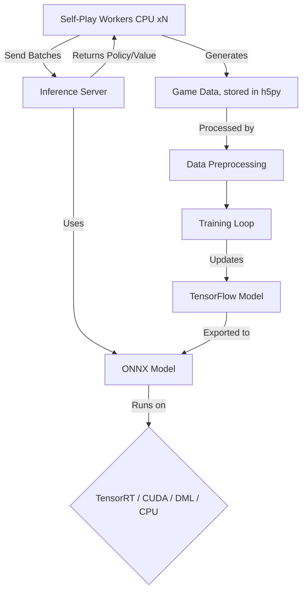

# AlphaZero General Implementation & Enhancements
A from scratch, high performance, implementation of DeepMind's Alpha Zero system in Tensorflow, featuring significant architectural and algorithmic improvements for efficiency, scalability, and performance. This project has been a long time dream of mine to complete.

To Henry, thanks for suggesting Alpha Zero to me in grade 10, I would never have come this far. Thank you for showing me my passion and my dream in life. Programming and ML has been the greatest passion I could have ever asked for. It has been a while but I'm nearing completion, I hope this shows you how far I've come from where I started. Again, thank you for showing me my path.

## 🚀 Key Features & Enhancements
This implementation includes the core AlphaZero algorithm but is significantly enhanced for performance and learning efficiency:


## 🎯 Core Implementation
General Game Framework: Framework capable of learning multiple perfect information games from scratch through self-play.

Monte Carlo Tree Search (MCTS): The core planning algorithm implemented as an implicit tree with memory efficiency in mind.

Residual Networks (ResNet): Standard deep neural network architecture for stable learning of complex value and policy functions.

## ⚡ Performance & Scalability
High-Performance Inference Server: A custom inference server that batches policy/value network requests from multiple MCTS workers. This is drastically more efficient than spawning multiple ONNX runtime instances, minimizing GPU overhead and maximizing throughput.

Multi-worker Self-Play: Parallel self-play data generation utilizing multiple CPU cores, significantly accelerating training.

Multi-Platform GPU Acceleration: Model exported to ONNX format for fast inference across multiple execution providers:

- TensorRT (NVIDIA GPU - Optimized)
- CUDA (NVIDIA GPU - Standard)
- DirectML (GPU - Windows)
- CPU (Fallback)

## 🧩 Implementation Checklist

### ✅ Completed Features

#### Core Algorithm & MCTS
- [x] Implicit MCTS Tree Representation (Memory-Optimized)
- [x] MCTS Node Pruning
- [x] Hybrid Training Target Z * 0.75 + Q * 0.25

#### Performance & Optimization
- [x] Numba JIT Acceleration for Critical Functions
- [x] Multi-Platform ONNX Inference (TensorRT, CUDA, DirectML, CPU)
- [x] Batch Inference Server for Parallel Workers
- [x] Neural Network Output Caching

#### Infrastructure & Data Management
- [x] Game Compatibility Test Suite
- [x] HDF5-Based Experience Replay Buffer

#### Network Architecture
- [x] Residual Network (ResNet) Blocks

#### Training Stabilization Techniques
- [x] GrokFast Optimization
- [x] OrthoGrad Regularization
- [x] StableMax Activation

### 🔄 In Progress / Planned

#### Parallelization & Gameplay
- [ ] Virtual Loss for Parallel MCTS (Paralleized MCTS)
- [ ] Rich Representation from: https://arxiv.org/abs/2310.06110

## 🕹️ Implemented Games

| Game                 | 	Status | Description                                 |
|----------------------|---------|---------------------------------------------|
| Tic-Tac-Toe          | 	✅      | Complete	Simple validation environment      |
| Connect4	            | ✅       | Complete	Classic 6x7 board game             |
| Gomoku	              | ✅       | Complete	5-in-a-row on a 15x15 board        |
| Ultimate Tic-Tac-Toe | 	🔄     | In Progress	Complex, strategic variant      |
| Chopsticks	          | 🔄      | In Progress	Simple perfect-information game |

# 🏗️ Project Architecture

## 🚦 Getting Started

### Installation & Training
Clone the repo:
```bash
git clone https://github.com/subtotechnoblade/Grok_Alpha_Zero
cd Grok_Alpha_Zero
```

### Install dependencies:
Pick the file matching what you want to do and what hardware you have. Install
exactly one — `onnxruntime`, `onnxruntime-gpu` and `onnxruntime-directml` all ship
the same `onnxruntime` python package and overwrite each other.

**Training** (builds, trains and exports models — includes TensorFlow):

| file | requires | notes |
| --- | --- | --- |
| `requirements-training-tensorrt.txt` | NVIDIA GPU | TensorRT + CUDA. Best for larger models (gomoku). |
| `requirements-training-directml.txt` | any DX12 GPU, **windows** | Best for small models (connect4). Works on AMD/Intel too. |
| `requirements-training-cpu.txt` | nothing | Slowest, but nothing to misconfigure. |

**Inference only** (play, self play, benchmarks — no TensorFlow, consumes an
existing `model.onnx`):

| file | requires |
| --- | --- |
| `requirements-inference-tensorrt.txt` | NVIDIA GPU |
| `requirements-inference-gpu.txt` | NVIDIA GPU, CUDA only (no engine build wait) |
| `requirements-inference-directml.txt` | any DX12 GPU, **windows** |
| `requirements-inference-cpu.txt` | nothing |

```bash
pip install -r requirements-training-directml.txt
```

Note: TensorFlow 2.10 was the last release with native Windows GPU support, so on
Windows **training runs on CPU** regardless of which file you pick. Only self play
inference is GPU accelerated there. Use WSL if you want GPU training.

The TensorRT files must **not** be installed with `--only-binary=:all:` —
`tensorrt-cu12` is an sdist stub that fetches the real wheels.

### Train Alpha Zero for Connect4
Run from the repository root, not from inside the game folder:
```bash
python pipeline.py --game Connect4
```
```bash
python pipeline.py --game Gomoku
```

Running from the root puts it on `sys.path`, so the shared modules (`MCTS`,
`Self_Play`, ...) and the game packages (`Connect4.game`, ...) each resolve under
exactly one name. Output for a run goes to `<game>/Grok_Zero_Train/`.

Each game folder holds everything for that game:

| file | holds |
| --- | --- |
| `game.py` | rules and the `@njit` kernels |
| `config.py` | hyperparameters, edited freely without recompiling `game.py` |
| `Build_Model.py` | network definition |
| `play.py` | pygame front end |
| `Grok_Zero_Train/` | that game's training output |

TicTacToe is still on the older config schema and keeps its own `TicTacToe/main.py`
until its config is migrated.

## Issues
- ~~numba unable to find the correct cache key. Solution: Delete pycache and restart training.~~
  Fixed. numba stamps its cache on the source file's mtime and size, so keeping the
  configs in the same file as the jitted kernels meant every hyperparameter tweak threw
  the cache away and each worker paid a ~5s recompile. `config.py` is a separate file
  now, so editing it leaves `game.py` cached (measured 5.20s to 0.68s).


## References & Acknowledgements

### Core Algorithm Papers
- **AlphaZero**: Silver, D., et al. (2017, December 5). Mastering Chess and Shogi by Self-Play with a General Reinforcement Learning Algorithm. https://arxiv.org/abs/1712.01815
- **MuZero**: Schrittwieser, J., et al. (2020, February 21). Mastering Atari, Go, Chess and Shogi by Planning with a Learned Model. https://arxiv.org/abs/1911.08265
- **Gumbel AlphaZero/MuZero**: Danihelka, I., et al. (2023, February 13). Policy improvement by planning with Gumbel. OpenReview. https://openreview.net/forum?id=bERaNdoegnO

### Network Architecture  
- **Residual Networks**: He, K., et al. (2015, December 10). Deep Residual Learning for Image Recognition. https://arxiv.org/abs/1512.03385
- **GARB Networks with attention and Alpha Zero training techniques**: Gao, Yifan & Wu, Lezhou. (2021). Efficiently Mastering the Game of NoGo with Deep Reinforcement Learning Supported by Domain Knowledge. Electronics. 10. 1533. 10.3390/electronics10131533. 

### Grokking Techniques
- **Grokfast**: Lee, J., et al. (2024, June 5). Grokfast: Accelerated Grokking by Amplifying Slow Gradients. https://arxiv.org/abs/2405.20233
- **Orthograd & Stablemax**: Prieto, L. et al. (2025, May 19). Grokking at the Edge of Numerical Stability. https://arxiv.org/abs/2501.04697

